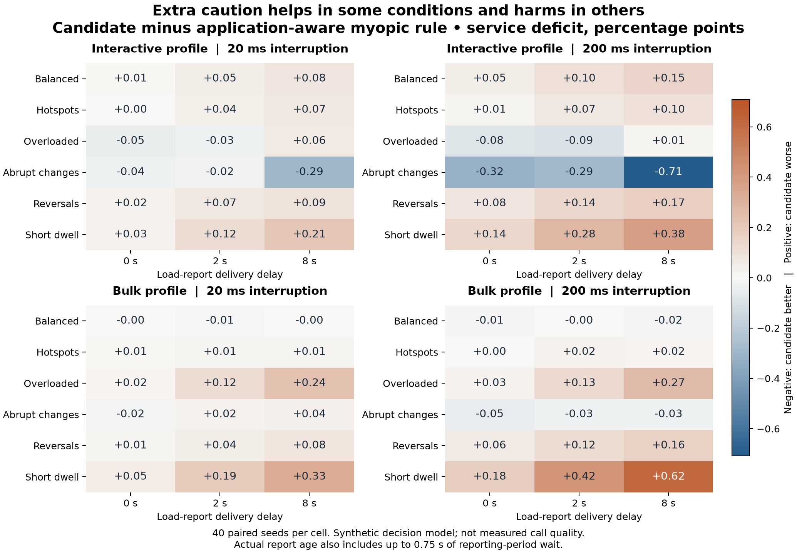

# Application-Aware Handoffs in Dense Wireless Networks

**Exploratory research package — 14 October 2026.** This repository contains a literature review, a precise research question, reproducible simulation code, results, and a plan for the next research stage. It is preparation for a paper, not a finished manuscript.

The central finding is that **fewer handoffs do not necessarily mean better service**. In our synthetic model, the candidate that adds switching-cost and old-report penalties improves on signal-only roaming but slightly worsens the main service score compared with a simpler application-aware rule. The negative result is retained and explained.

## Start here

1. [Research overview and main conclusions](docs/overview.md)
2. [Research question and hypotheses](docs/research-question.md)
3. [Recent literature](docs/literature/recent-review.md), [older foundations](docs/literature/foundations.md), and [mechanisms and tools](docs/literature/mechanisms-and-evidence.md)
4. [Exact simulation model](docs/simulation-model.md) and [experimental design](docs/experiment-design.md)
5. [Main results](docs/results.md) and [service-estimation error test](docs/model-mismatch.md)
6. [Research decisions](docs/research-process.md), [independent review](docs/independent-review.md), and [next research steps](docs/next-steps.md)

The [source index](references/source-index.md) covers **28 distinct sources: 21 research works and 7 technical documents**. Fourteen research works received selected full-text inspection; seven were reviewed at abstract or excerpt level. Sixteen research works are from 2023–2026. The review is targeted, not exhaustive. Checked records and a [BibTeX bibliography](references/bibliography.bib) are included.

New to the terms? Read the [short glossary](docs/glossary.md).

## What was actually run

- Main evaluation: **17,280 policy runs**, covering 72 settings × 40 seeds × 6 policies.
- The main grid reuses **240 underlying world traces**. The policy runs are not 17,280 independent real-world experiments.
- A pilot-tuned fixed-margin application baseline adds **2,880 evaluation runs**.
- A service-model mismatch diagnostic adds **5,760 runs**.
- Pilot tuning, a horizon sensitivity check, raw seed results, uncertainty intervals, and run manifests are saved too.

This is a **decision-level simulation** using assumed signal, load, delay, and loss equations. It is not an IEEE 802.11 protocol simulator, an ns-3 experiment, a physical testbed, or a measurement of video quality. It makes no claim of a new algorithm or improved real-device performance.



Negative values favor the candidate; positive values favor the simpler rule. Values are percentage-point differences on an artificial service-deficit scale. [Full paired results and intervals](results/paired_comparisons.csv).

## Reproduce

Python 3.10 or later is expected; the recorded run used Python 3.14.5. Simulation and analysis use the standard library. From the repository root:

```sh
python3 -m unittest discover -s tests -v
python3 scripts/run_study.py --output work/reproduction
python3 scripts/run_static_margin.py --main-results work/reproduction --output work/static-reproduction
python3 scripts/run_model_mismatch.py --main-results work/reproduction --output work/mismatch-reproduction
```

The study chooses parameters on pilot seeds and evaluates on different seeds. Repeated runs should reproduce the numerical results in the recorded environment; timestamps and runtime will change. Use a new output directory to preserve the delivered evidence. See [reproduction details](docs/reproduction.md) for verification and figures.

## What remains before stronger paper claims

The nearest 2026 application-aware papers need full-method comparison. The service model needs calibration or a stronger application model. Candidate measurement errors, realistic scanning, interacting clients, and different environments need additional experiments. [The research plan](docs/next-steps.md) explains these steps and how to decide which are necessary for the intended paper.

No external paper has been independently replicated here. No hardware experiment has been performed. Code and documentation were prepared with AI assistance and reviewed with automated checks and an independent agent review. Research authors should verify the final claims and follow the chosen venue's disclosure policy.
