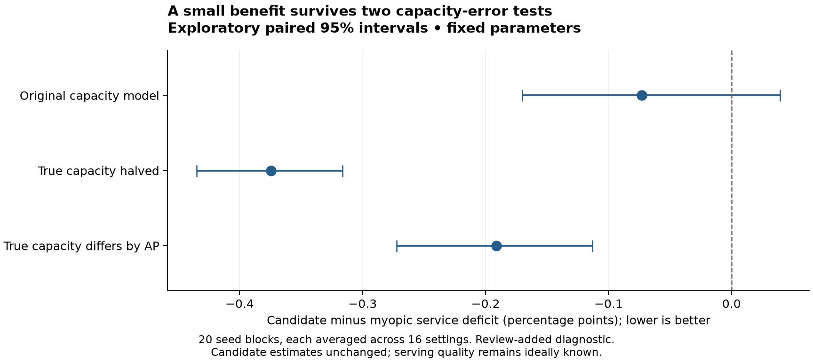

# What happens when the service estimate is wrong

This secondary experiment changes the simulated truth while leaving the policy's candidate-service formula unchanged. It was added during the independent review. It is an exploratory sensitivity check, not an independent real-world validation.

## Why this test was needed

In the main experiment, the policy knows the simulator's service formula. Only candidate load reports are old. A policy can look good under that favorable condition and fail when its estimate of an AP's capacity is wrong.

Here, each policy still receives the same observation mechanism. Candidate estimates use the original formula. Fresh serving-AP service is still ideally known, as in the main experiment. This is useful for isolating candidate-estimation error, but is still easier than real measurement.

## What changed

Three cases use the same traces:

| Case | True capacity | Candidate estimate |
| --- | --- | --- |
| Matched | Original capacity formula | Original formula |
| Half capacity | Every AP's capacity is multiplied by 0.5 | Original formula, so it is too optimistic |
| Uneven capacity | Each AP has a fixed factor drawn uniformly from 0.35 to 1.0 for that seed | Original formula, so errors differ between APs |

The changes also affect the rate-related part of the modeled RTT. They do not add a new physical radio model. The test uses the hotspots and abrupt-change scenarios, both application profiles, report delays of 0 and 8 seconds, and interruptions of 20 and 200 milliseconds. There are 20 evaluation seeds, reused from the main experiment. Parameters are frozen; there is no retuning.

There are **5,760 policy runs**: 3 truth cases × 2 scenarios × 2 profiles × 2 report delays × 2 interruption durations × 20 seeds × 6 policies. All results, including exact per-AP factors, are saved in [the result directory](../results/model_mismatch/).

## Results

The table compares the candidate with the application-aware myopic rule. Lower service deficit is better. The difference is candidate minus comparator in **percentage points**.

| True capacity case | Candidate deficit | Myopic deficit | Difference | Exploratory 95% interval |
| --- | ---: | ---: | ---: | ---: |
| Matched | 16.021% | 16.094% | −0.073 | −0.170 to +0.040 |
| Half capacity | 29.285% | 29.659% | −0.374 | −0.435 to −0.316 |
| Uneven capacity | 24.170% | 24.361% | −0.191 | −0.272 to −0.113 |

For each seed, differences are averaged across the 16 tested settings. The bootstrap then resamples these 20 seed blocks. This keeps settings that share a seed together. The intervals describe the average for this exact mix of settings; they are not per-cell guarantees and are not corrected for multiple comparisons.

The candidate retained a small average advantage over the myopic rule in these two capacity-error cases. Absolute service became much worse when capacity was overestimated. The matched-case interval includes zero. These findings do not show that the candidate handles all model errors, and they do not prove that its age term is needed.



The tuned static-margin diagnostic was a separate experiment and is not included in this mismatch run. Therefore, this test cannot establish an advantage over that stronger comparator. Underestimation, changing errors, delayed serving measurements, and alternative delay/loss laws remain untested here.

## Reproduce and inspect

After producing the main run's selected parameters:

```sh
python3 scripts/run_model_mismatch.py --main-results results --output work/mismatch-reproduction
```

The configuration is [model-mismatch.json](../configs/model-mismatch.json). [Raw seed results](../results/model_mismatch/seed_metrics.csv), [paired block comparisons](../results/model_mismatch/paired_block_comparisons.csv), and [the run manifest](../results/model_mismatch/run_manifest.json) support the table. Two tests check that a factor of one reproduces the original truth and that changing truth does not silently change candidate predictions.
