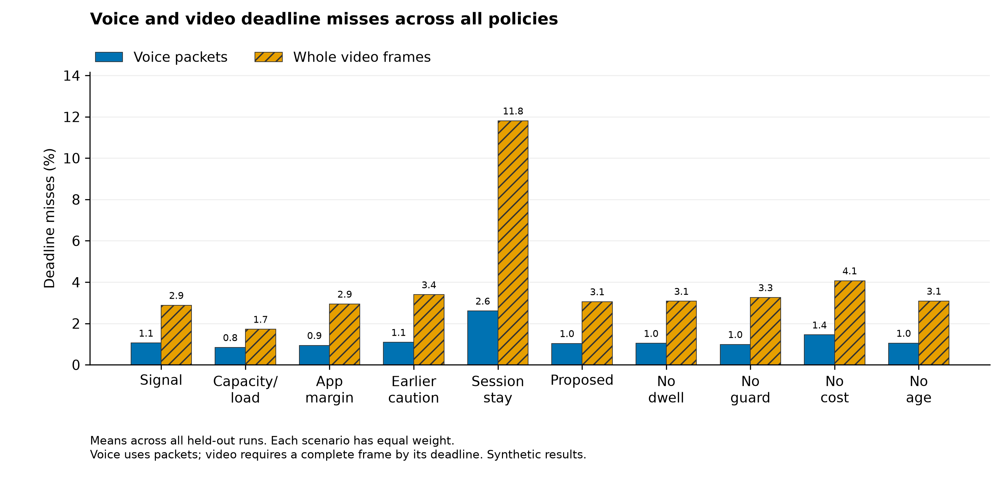
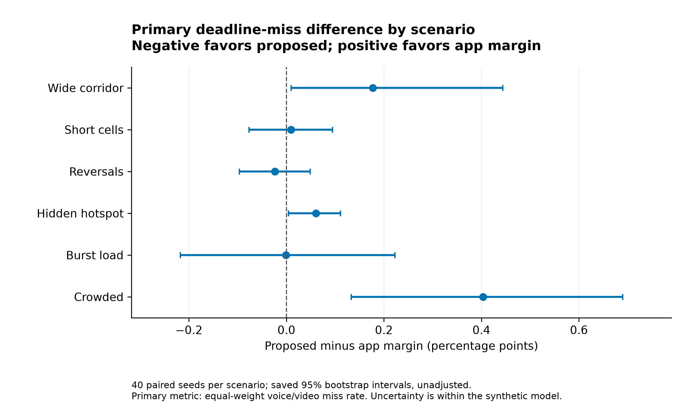
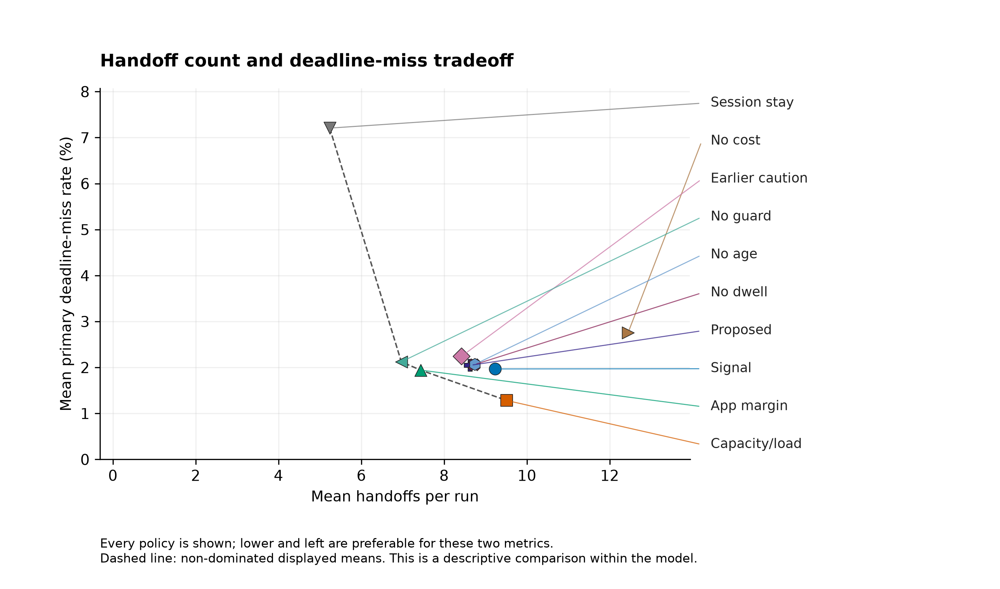
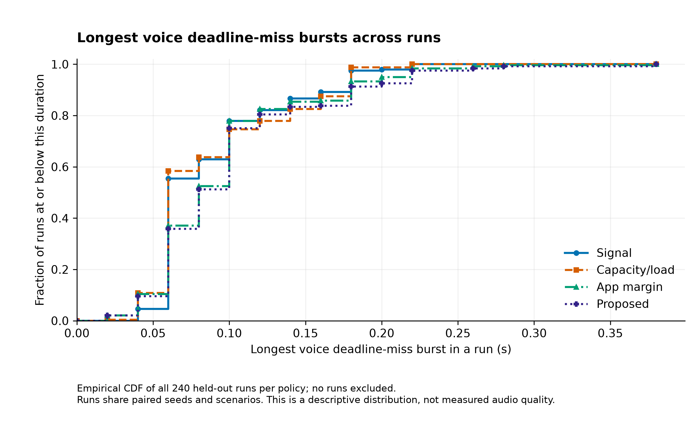
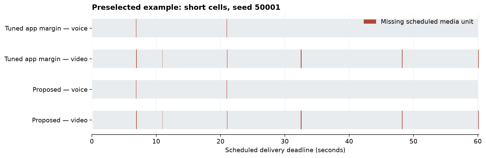

# Results of the packet-and-queue study

Study completed on **14 October 2026**. This report describes version 2. The [earlier version 1 results](results.md) remain available as a separate historical experiment.

## The main result

The proposed rule did **not** improve the main outcome over the independently tuned application-margin rule. Its mean deadline-miss score was **2.0471%**, compared with **1.9427%** for application margin. The difference was **+0.1044 percentage points**, with a paired 95% bootstrap interval from **+0.0384 to +0.1732 points**. Positive differences mean more missed deadlines for the proposed rule.

The capacity/load rule had the lowest overall score among the ten tested rules: **1.2821%**. The signal rule scored **1.9680%**. These are results for the declared mix of six synthetic scenarios. They do not establish the best rule for every Wi-Fi network.

The proposed rule also made **more handoff attempts than application margin**: 8.63 versus 7.43 per run. The earlier study's account of fewer switches cannot be carried into this result. Extra decision terms did not automatically produce better delivery or fewer moves.

## What the score means

Each run generates voice-like packets and video-like frames for 60 seconds, followed by enough drain time to evaluate the final deadlines. The default traffic uses one voice packet every 20 ms and 30 video frames each second. Voice packets have a 60 ms delivery budget and video frames have a 150 ms budget. These are study assumptions, not universal limits for calls.

A voice packet is missed if it is not fully delivered by its deadline. A video frame is missed if any of its packets is missing or late. The primary score is:

`deadline-miss score = (voice miss percentage + video frame miss percentage) / 2`

This gives the two streams equal weight. It does not pool their packet counts. A 2% score is not a claim that 2% of the call was unintelligible or frozen. There is no real codec, decoder, concealment mechanism, or human quality assessment in the model. Both components are reported below so that the combined score does not hide their differences.

## Every policy is retained

The table uses the same names as the figures. The code keys make each method easy to find in the raw files. Handoffs are **attempts**, including attempts that fail.

| Figure name | Code key | Primary score, % | Voice misses, % | Video misses, % | Mean handoff attempts |
|---|---|---:|---:|---:|---:|
| Signal | `rssi` | 1.9680 | 1.055 | 2.881 | 9.23 |
| Capacity/load | `load_aware` | 1.2821 | 0.841 | 1.723 | 9.51 |
| App margin | `app_myopic` | 1.9427 | 0.942 | 2.944 | 7.43 |
| Earlier caution | `cautious_v1` | 2.2433 | 1.091 | 3.396 | 8.42 |
| Session stay | `session_stay` | 7.2066 | 2.607 | 11.806 | 5.24 |
| Proposed | `predictive` | 2.0471 | 1.035 | 3.059 | 8.63 |
| No dwell | `no_dwell` | 2.0594 | 1.041 | 3.078 | 8.72 |
| No guard | `no_guard` | 2.1231 | 0.989 | 3.257 | 6.97 |
| No cost | `no_cost` | 2.7597 | 1.450 | 4.070 | 12.45 |
| No age | `no_age` | 2.0680 | 1.049 | 3.087 | 8.74 |

Each row averages 240 runs: six scenarios and 40 seeds. The full values are in [policy_summary.csv](../results/packet/policy_summary.csv). “Proposed” is a simple signal-trend heuristic with cost, report-age and safety terms; it is not a trained AI model. The four “No” variants remove one component while retaining the proposed rule's frozen settings. They were not tuned separately. [The model document](packet-model.md) defines each rule.

The capacity/load rule has the lowest overall mean for both streams. Session stay makes the fewest handoff attempts but has the largest combined miss score. Removing the proposed rule's handoff-cost term raises its mean score and switching count in this test. These comparisons describe the tested settings; they do not establish a universal component benefit.

## Different scenarios give different answers

The figure shows the proposed rule minus application margin. Left of zero favors the proposed rule; right of zero favors application margin. All six scenarios are shown, including the crowded scenario where the proposed rule has the largest mean penalty. The intervals are unadjusted secondary comparisons within the model.

Capacity/load is also not a universal winner. It has the lowest mean in wide corridor, reversals, hidden hotspot and crowded. Signal has the lowest mean in burst load, and application margin has the lowest mean in short cells. Specifically, capacity/load is worse than signal by **0.2839 points** in burst load and worse than application margin by **0.2114 points** in short cells. These are secondary paired comparisons; see [the independent numerical review](../results/packet/additional_load/main-numerical-review.md) and [all scenario means](../results/packet/scenario_summary.csv).

## Handoffs and missed deadlines must be read together

Lower and left means a better combination of these two measures. The dashed line connects displayed means for which no other tested rule is both at least as good on the score and at least as good on handoff count, with one strict improvement. It is a descriptive comparison, not an uncertainty test.

The proposed rule is above and to the right of application margin: it has both a higher miss score and more attempts on average. Capacity/load attempts more handoffs than application margin but delivers a lower average score. This is why counting switches alone is not enough.

There are smaller trade-offs too. The proposed rule's mean longest run of missed video-frame deadlines is 458.8 ms, compared with 482.1 ms for application margin. Yet its mean primary score is worse. Capacity/load has a shorter mean video deadline-miss run of 314.7 ms, but slightly lower aggregate background delivery than the proposed rule: 96.1533% versus 96.2232%. These are secondary measures inside the assumed scheduler; they do not measure decoded video freezes or real-user fairness.

## Long voice deadline-miss runs

For each simulated run, we find the longest consecutive sequence of voice packets that miss their deadlines. Its length is the number of packets multiplied by the 20 ms packet interval. The graph shows the fraction of runs at or below each duration for Signal, Capacity/load, App margin and Proposed, matching the manuscript. It includes every one of the 240 runs for each named method.

The proposed rule does not show a general reduction in this measure. Its mean per-run maximum is about 101 ms, versus 97 ms for application margin and 89 ms for signal. A real audio decoder could conceal some missing packets or behave differently. These are scheduled-deadline proxies, not measured silence durations.

## A preselected example over time

This timeline uses short cells and seed 50001, from the diagnostic set selected before evaluation. Colored marks show scheduled media units that missed delivery deadlines. The two rules have the same total voice misses, video misses and handoff attempts in this example. One example cannot establish the average result; the complete main tables do that. [The saved trace archive](../results/packet/selected_traces.json.gz) covers 18 diagnostic replays, not only this picture.

## Sensitivity checks

Eight conditions change the deadline budgets, transition cost, report age, assumed handoff cost, service time step, or whether queued packets survive a handoff. The original check uses four methods in four scenarios and ten seeds per condition: **1,280 runs**. A separately recorded addition evaluates the frozen capacity/load rule in those same conditions: **320 more runs**. No sensitivity result was used to retune the policies.

The capacity/load rule has a lower aggregate score than the proposed rule in all eight supplementary conditions. The proposed-minus-capacity/load difference ranges from **+0.2432 points** with a 20 ms service step to **+2.2490 points** with stale reports. The comparable 10 ms reference difference is **+0.9832 points**; this reference uses the same four scenarios and ten seeds, not the full main average.

The proposed rule also has a higher mean score than application margin in all eight conditions. Three of those paired intervals include zero: relaxed deadlines, stale reports and the 20 ms step. The table reports every condition; positive values mean more misses for the proposed rule. The original application-margin comparisons are in [sensitivity_overview.csv](../results/packet/sensitivity_overview.csv), including their full intervals.

| Condition | Proposed minus app margin, points | Proposed minus capacity/load, points |
|---|---:|---:|
| Matched 10 ms reference | +0.1725 | +0.9832 |
| Tight deadlines | +0.4928 | +1.7662 |
| Relaxed deadlines | +0.0875 | +0.7408 |
| Costly transitions | +0.8183 | +1.5429 |
| Stale reports | +0.0957 | +2.2490 |
| Handoff cost underestimated | +0.1972 | +1.0079 |
| 5 ms service step | +0.2699 | +1.2249 |
| 20 ms service step | +0.1074 | +0.2432 |
| Queue retained at handoff | +0.1906 | +1.1628 |

The 20 ms result differs enough from the 5 ms and 10 ms results that we cannot claim numerical convergence. Retaining queued packets at a handoff does not reverse the aggregate ordering. Across these checks, the proposed rule has a small background-delivery advantage of about 0.095–0.125 percentage points over capacity/load, so the foreground result comes with a trade-off.

These comparisons use only ten seed blocks, and their 95% intervals are secondary and unadjusted. They do not validate the assumed radio or rate model. [The complete supplementary table](../results/packet/additional_load/overview.md) and [sensitivity interpretation](../results/packet/additional_load/sensitivity-numerical-review.md) retain all conditions, components and trade-offs. [The supplementary plan](packet-load-supplement.md) explains when and why that comparison was added.

## How the evidence was produced

The main evaluation contains **2,400 policy runs in 240 paired external worlds**, not 2,400 independent networks. The policies share external random inputs within each scenario and seed. Their actions can still produce different queues and later load observations. The model has one roaming device, finite queues, delayed and noisy reports, scanning interruptions, fractional handoff durations and possible failures.

Development used different seeds and environments. After the initial results, the team made one documented grid extension before held-out evaluation. Both development rounds are saved. The tuning budgets are unequal, and the proposed rule received more tested configurations. This is an internal prospective protocol with a development-informed amendment, not external preregistration.

For the primary interval, each seed contributes one difference averaged equally across all six scenarios. The analysis then resamples the 40 seed blocks 5,000 times. Packets, time steps and policy rows are not treated as independent replicates. The interval covers variation across these seeded conditions. It does not cover uncertainty about physical networks or every possible scenario.

The controller and outcome model share the assumed signal-to-rate curve. Capacity/load therefore has correctly specified rate calibration within this experiment, even though its observations are delayed and noisy. The handoff-cost error check does not test a wrong radio-rate curve. Rich candidate telemetry, the airtime-sharing rule, transition assumptions and lack of inter-AP interference also limit generalization. [The full model](packet-model.md) states these limits explicitly.

## Files, checks and reproduction

- [Raw main runs](../results/packet/main_runs.csv), [policy means](../results/packet/policy_summary.csv), [scenario means](../results/packet/scenario_summary.csv), and [paired contrasts](../results/packet/paired_contrasts.csv).
- [Frozen settings](../results/packet/frozen_parameters.json), [evaluation manifest](../results/packet/run_manifest_evaluate.json), and [analysis manifest](../results/packet/analysis_manifest.json).
- [All figures as PNG and PDF](../results/packet/figures/), with [figure input hashes](../results/packet/figures/figure_manifest.json).
- [Study protocol](packet-study-protocol.md), [research decision log](full-study-decisions.md), [independent model review](packet-independent-review.md), and [independent numerical review](../results/packet/additional_load/main-numerical-review.md).
- [Complete reproduction instructions](packet-reproduction.md), including tests, the supplement, trace checks and artifact validation.

The literature record contains 34 distinct sources: 21 research works and 13 technical documents. The [source index](../references/source-index.md) and [packet sources](../references/packet-sources.json) distinguish the reading depth and source type. The nearest recent application-aware studies were not fully reproduced here. Code, analysis, figures and writing were AI-assisted; automated and independent agent checks do not replace human authorship review or external peer review.

The research result is a bounded negative finding: under these declared conditions, the more complex proposed rule did not beat a tuned application-margin baseline. A simpler capacity/load rule performed better overall, with clear exceptions. The [LaTeX manuscript](../paper/wifi-roaming-paper.tex) and [PDF](../paper/wifi-roaming-paper.pdf) present this evidence in a complete 15-page paper with six figures and five tables.
